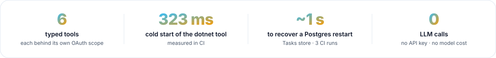
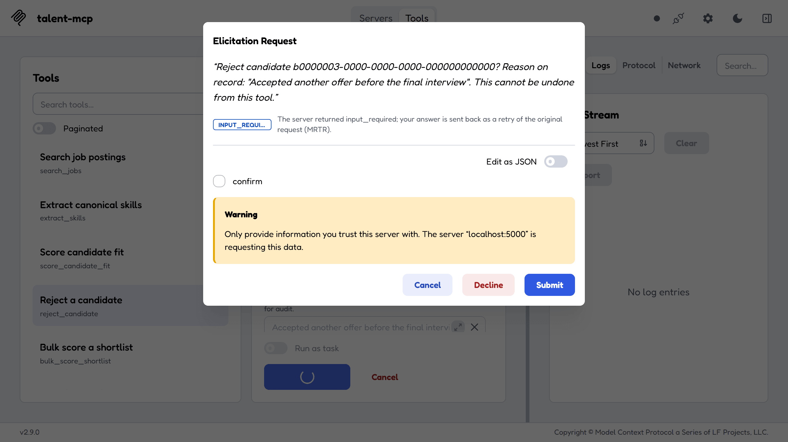
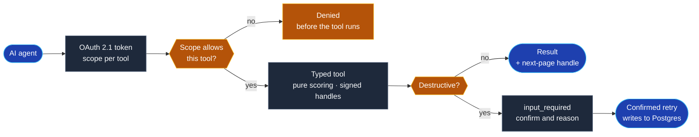

<div align="center">

<picture>
  <source media="(prefers-color-scheme: dark)" srcset="docs/readme/hero-dark.svg">
  
</picture>

<br><br>

<a href="https://github.com/Juxn89/talent-mcp/actions/workflows/ci.yml"></a>


<a href="https://www.nuget.org/packages/Talent.Mcp.Toolkit"></a>
<a href="https://www.nuget.org/packages/Talent.Mcp.Server"></a>
<a href="LICENSE"></a>

</div>

<br>

<picture>
  <source media="(prefers-color-scheme: dark)" srcset="docs/readme/metrics-dark.svg">
  
</picture>

<br><br>

AI agents can now call tools: search your data, create records, take actions. Connecting one to a real
system raises the questions that matter — what it may read, what it may change, who confirms before
something is deleted, and how you audit what it did. **talent-mcp** answers them for a domain where
mistakes are costly, recruiting: an MCP server in C# with six typed tools, a separate OAuth scope for
reading, writing and destroying, and a confirmation round trip before any rejection. It is built
against the **2026-07-28 Model Context Protocol revision** — the one that removed sessions — over
stateless Streamable HTTP, and ships the same six tools over stdio as a `dotnet tool`.

> [!NOTE]
> **No tool calls an LLM.** Scoring and skill normalization are deterministic pure functions, so the
> server runs with no API keys, at zero cost, and its results are reproducible enough to be a test
> oracle. The screenshots in [`docs/demo`](docs/demo) are the running server seen through
> [MCP Inspector](https://github.com/modelcontextprotocol/inspector) 2.9.0; every number on this page
> comes from CI or the [changelog](CHANGELOG.md).

<p align="center">
  <picture>
    <source media="(prefers-color-scheme: dark)" srcset="docs/readme/showcase-dark.png">
    
  </picture>
</p>
<p align="center"><sub><code>reject_candidate</code> does not reject on the first call: it answers <code>input_required</code>, and only a confirmed retry writes. Seen in MCP Inspector against the seed data · <a href="docs/demo">all screenshots</a></sub></p>

<p align="center"></p>

## How it works



1. The agent gets a token from Keycloak whose scopes name what it may do; each tool checks its own
   scope, and a token without it is denied before the tool runs.
2. Reads are pure functions over Postgres data: the same question always returns the same answer,
   with the breakdown behind every score.
3. State between calls is a signed, time-limited handle passed back as an ordinary argument, so any
   replica can answer any request.
4. A destructive tool answers with a question first. Only the client's confirmed retry performs the
   write, and the reason travels inside the signed request state, so it cannot change in between.

## What's inside

<table>
  <tr>
    <td width="33%" valign="top">
      <br>
      <b>Confirmation before destruction</b><br>
      <sub><code>reject_candidate</code> answers <code>input_required</code> (MRTR) and only a confirmed retry writes, with a safe path when the client cannot ask.</sub>
    </td>
    <td width="33%" valign="top">
      <br>
      <b>A scope per tool</b><br>
      <sub>Read, write and destructive scopes are not interchangeable. The E2E suite proves a token without the scope is denied.</sub>
    </td>
    <td width="33%" valign="top">
      <br>
      <b>Signed handles, no sessions</b><br>
      <sub>Pagination and confirmation state travel as signed, TTL-bounded handles, so the HTTP host scales out with no sticky sessions.</sub>
    </td>
  </tr>
  <tr>
    <td valign="top">
      <br>
      <b>Explainable scores</b><br>
      <sub>Candidate fit is a pure function with a per-component breakdown: skills, seniority, location, each with its weight and reason.</sub>
    </td>
    <td valign="top">
      <br>
      <b>Tasks that survive a restart</b><br>
      <sub><code>bulk_score_shortlist</code> runs on the Tasks extension, stored in Postgres; the store recovers a database restart in about a second.</sub>
    </td>
    <td valign="top">
      <br>
      <b>One tool surface, two hosts</b><br>
      <sub>Stateless Streamable HTTP as a container image, and stdio as a <code>dotnet tool</code> for Claude Code and Claude Desktop.</sub>
    </td>
  </tr>
  <tr>
    <td valign="top">
      <br>
      <b>Traced and measured</b><br>
      <sub>One trace from the client's call through the tool to every Postgres command, plus a provisioned Grafana dashboard for latency and errors per tool.</sub>
    </td>
    <td valign="top">
      <br>
      <b>Five test levels gate the merge</b><br>
      <sub>Architecture rules, domain, tools in memory, protocol conformance for 2026-07-28, and end to end through OAuth and Postgres.</sub>
    </td>
    <td valign="top">
      <br>
      <b>Published</b><br>
      <sub>On NuGet as a reusable protocol toolkit and as the <code>talent-mcp</code> tool, plus an image on GHCR. The release tag sets every version.</sub>
    </td>
  </tr>
</table>

## Run it

```bash
git clone https://github.com/Juxn89/talent-mcp.git && cd talent-mcp
docker compose -f deploy/compose.yaml up -d --wait
dotnet run --project src/Talent.Mcp.Server
```

That brings up Postgres, Keycloak with the realm imported, and the full OpenTelemetry stack:

| | |
|---|---|
| Keycloak | <http://localhost:8080> — `admin` / `admin` |
| Realm discovery | <http://localhost:8080/realms/talent/.well-known/openid-configuration> |
| Grafana | <http://localhost:3000> — dashboards provisioned from `deploy/grafana/` |
| Jaeger | <http://localhost:16686> |
| Prometheus | <http://localhost:9090> |
| Loki | <http://localhost:3100> |
| OTLP intake | `localhost:4317` (gRPC), `localhost:4318` (HTTP) |
| Postgres | `localhost:5432` — `talent` / `talent`, databases `talent` and `keycloak` |
| Keycloak realm user | `recruiter` / `recruiter` |

Every credential above is a dev-only default and every one is overridable from the environment.
Image tags are pinned to exact patch versions, because `latest` makes a green CI run
unreproducible three weeks later.

Running under `Development` also applies the migrations and inserts realistic seed jobs and
candidates, so `search_jobs` has something to find on the first call. That is
`Talent:Database:MigrateAndSeedOnStartup`, and it is **off** anywhere else: the HTTP host can run as
several replicas whose migrations would race, the stdio host is launched once per client session on a
path where the check would cost every session, and a schema change should be a deploy step somebody
ran rather than a side effect of a process starting. Seeding is idempotent, so a restart on an
existing volume inserts nothing.

To apply the schema without the flag — a real deployment, say — the ordinary EF path still works:

```bash
dotnet ef database update --project src/Talent.Infrastructure --startup-project src/Talent.Mcp.Server
```

```bash
docker compose -f deploy/compose.yaml down     # add -v to drop the volume and force a realm re-import
```

The MCP server is deliberately **not** a compose service: the conformance and E2E suites build it
in-process so they can assert against the same composition the tests exercise.

---

## The tools

Each one exists to demonstrate a specific capability of the revision. None is decorative.

| Tool | Scope | What it demonstrates |
|---|---|---|
| `search_jobs` | `talent.jobs.read` | Pagination by **signed handle** — the pattern that replaces sessions |
| `get_job` | `talent.jobs.read` | Cacheable result with `ttlMs`/`cacheScope`, plus region routing promoted to a header via `[McpHeader("Region")]` |
| `extract_skills` | `talent.jobs.read` | Taxonomy normalization, deterministic and LLM-free |
| `score_candidate_fit` | `talent.candidates.read` | Explainable score with a per-component breakdown |
| `reject_candidate` | `talent.candidates.reject` | A destructive operation gated on **MRTR** confirmation, including the degraded path |
| `bulk_score_shortlist` | `talent.candidates.write` | Long-running work on the **Tasks extension**, backed by Postgres so it survives a restart |

Scopes are enforced **per tool** — read, write and destructive are not interchangeable — and the
E2E suite asserts that a token missing the required scope is denied.

---

## The flow, end to end

What makes this revision different, in the order you hit it. Request bodies below are the real wire
shapes; run the commands against your own stack for live values.

**1. Get a token.** Every tool call needs one, and the scope has to match the tool.

```bash
TOKEN=$(curl -s -X POST http://localhost:8080/realms/talent/protocol/openid-connect/token \
  -d grant_type=password -d client_id=talent-mcp-client \
  -d username=recruiter -d password=recruiter \
  -d scope='talent.jobs.read talent.candidates.read' | jq -r .access_token)
```

**2. Search, and page with a handle — not a session.** There is no `Mcp-Session-Id` and no
`initialize`. State between calls travels as a signed, TTL-bounded handle passed back as an ordinary
tool argument.

```bash
curl -s -X POST http://localhost:5000/mcp \
  -H "Authorization: Bearer $TOKEN" \
  -H 'MCP-Protocol-Version: 2026-07-28' \
  -H 'Mcp-Method: tools/call' -H 'Mcp-Name: search_jobs' \
  -H 'Content-Type: application/json' \
  -d '{"jsonrpc":"2.0","id":1,"method":"tools/call","params":{
        "name":"search_jobs",
        "arguments":{"query":"engineer","pageSize":2},
        "_meta":{"io.modelcontextprotocol/protocolVersion":"2026-07-28",
                 "io.modelcontextprotocol/clientCapabilities":{}}}}'
```

The result carries `nextPageHandle`, which you pass straight back as an argument to get page two:

```jsonc
{ "jobs": [ /* … */ ], "totalMatches": /* … */, "hasMore": true,
  "nextPageHandle": "AAAAAGqQKRi4yPyKLkvv9…" }
```

> `hasMore` is an explicit field on purpose. The serializer omits nulls, so on the last page
> `nextPageHandle` is **absent**, not `null` — a client that treats "no more data" as the absence of
> another field is reading a serialization detail as a protocol signal.

**3. Reject a candidate — and get told no.** The first call does not delete anything. It raises
`InputRequiredException`, which reaches the client as an `input_required` result carrying a
`requestState` handle:

```bash
# … "name":"reject_candidate", "arguments":{"candidateId":"…","reason":"Withdrew"}
```

The client re-sends the *original* request with `inputResponses` filled in, and only then does the
rejection happen. That round trip is MRTR, and it is the only mechanism the revision leaves for a
server to ask a question — server-initiated requests are gone.

If the client cannot elicit, the tool takes a degraded path instead of failing. The guard is
`IsMrtrSupported && ClientCapabilities?.Elicitation is not null`: the first asks whether the
mechanism exists, the second whether anyone is there to answer.

**4. Watch it in Jaeger.** Client context arrives in `_meta` as `traceparent`/`tracestate`/`baggage`,
so one trace spans client → tool → Postgres: Npgsql's command spans hang off the tool span. Open
<http://localhost:16686> and pick `talent-mcp-http`; Grafana has latency and errors per tool.

---

## Architecture

Clean Architecture, with the dependency rule verified in CI rather than agreed to in a document.

```
Presentation ──┐
               ├──▶ Application ──▶ Domain
Infrastructure ┘

Dependencies point inward only. Domain references nothing.
```

| Project | Role |
|---|---|
| `Talent.Domain` | Entities and the pure scoring and normalization functions. Zero framework dependencies |
| `Talent.Application` | Use cases and ports (`IJobRepository`, `ICandidateRepository`, `IHandleCodec`) |
| `Talent.Infrastructure` | Adapters: EF Core/Npgsql, migrations, seeds, Keycloak, OTel exporters |
| `Talent.Mcp.Tools` | The six tool types and their wire contracts, shared verbatim by both hosts |
| `Talent.Mcp.Server` | ASP.NET Core Streamable HTTP host → the GHCR image |
| `Talent.Mcp.Server.Stdio` | stdio host → the `talent-mcp` dotnet tool |
| `Talent.Mcp.Toolkit` | Domain-agnostic protocol primitives → NuGet |

`Talent.Mcp.Tools` references neither `Talent.Infrastructure` nor `ModelContextProtocol.AspNetCore`,
which is what lets the stdio host serve the identical surface without dragging the web stack into a
process where cold start is the whole point. `Talent.Architecture.Tests` fails the build if that
changes.

---

## Testing

Five levels with distinct jobs. **All five gate the merge** — they do not merely report.

```bash
# No Docker needed
dotnet test tests/Talent.Architecture.Tests    # the dependency rule
dotnet test tests/Talent.Domain.Tests          # pure scoring and normalization
dotnet test tests/Talent.Mcp.Tests             # tools over the in-memory transport

# Needs the stack
docker compose -f deploy/compose.yaml up -d --wait
dotnet test tests/Talent.Infrastructure.Tests  # EF mapping against real Postgres
dotnet test tests/Talent.Mcp.Conformance       # protocol conformance for 2026-07-28
dotnet test tests/Talent.Mcp.E2E               # real client → HTTP → OAuth → Postgres

dotnet test                                    # everything
```

The conformance suite carries the most signal. It asserts that `tools/list` returns all six tools
**by name** — not merely that the server starts. A tool set silently emptied by trimming answers
`-32601` with no crash and no error log, which is this project's worst failure mode and the reason
tools are registered explicitly rather than by assembly scan.

---

## Benchmarks

```bash
dotnet run --project bench/Talent.Mcp.Bench -c Release
```

Both targets are pure functions over `Talent.Domain` — no repository, no `DbContext`, no Docker —
which is what makes the numbers reproducible rather than a description of one machine's Postgres.

`CandidateFitScorer.Score` is measured for a single pair and across a 500-candidate shortlist, the
ceiling `bulk_score_shortlist` works to. `SkillNormalizer.Extract` is measured across three CV
lengths, because its cost is proportional to alias count times text length rather than flat.

Cold start and memory for the stdio host are measured separately, in CI rather than on a laptop, by
the `startup-benchmark` job:

| Configuration | Time to serving | Peak RSS | Size | Shipped? |
|---|---:|---:|---:|:--:|
| **Installed `dotnet tool`** | **323 ms** | 84.8 MB | 20.9 MB | **yes** |
| Framework-dependent publish | 324 ms | 84.9 MB | 12.5 MB | — |
| Self-contained, ReadyToRun | 177 ms | 89.0 MB | 105.4 MB | — |
| Self-contained, trimmed | **does not start** | — | 39.9 MB | — |

**~323 ms is what you actually pay.** The apphost shim and muxer resolution that `dotnet tool
install` adds cost nothing measurable over a bare publish directory, which was not the expectation.

ReadyToRun nearly halves that, but it is not currently shippable where it would matter: cold start is
a per-session cost for the stdio host, and that host reaches you as portable IL, which R2R would trade
for a package per platform. Applying it to the container image instead would be theatre — that is a
long-lived server whose startup is paid once.

Trimming is not merely slower: the host throws at startup, because the SDK builds tool schemas by
reflecting over parameter types and a domain enum has no metadata once trimmed. The trim analyzer
never warned — it reported two unrelated EF Core diagnostics.
[ADR-0007](./docs/adr/0007-trim-clean-over-native-aot.md) has the stack trace and what reversing it
would cost.

Results and what they mean are in
[`docs/verification/domain-benchmarks.md`](./docs/verification/domain-benchmarks.md). The short
version: scoring a full 500-candidate shortlist costs about a millisecond, so whatever makes
`bulk_score_shortlist` long-running is the data access around it, not the scorer. Allocation figures
there are byte-identical across runs; the wall-clock ones were taken on a throttled laptop and are
reported as orders of magnitude, not as measurements.

---

## Configuration

Settings bind from `appsettings.json`, environment variables, or any other `IConfiguration` source.
Environment variables use `__` for the `:` separator.

| Setting | Environment variable | Purpose |
|---|---|---|
| `ConnectionStrings:Talent` | `ConnectionStrings__Talent` | Postgres, in Npgsql keyword format (not a URI) |
| `Talent:HandleSigningKey` | `Talent__HandleSigningKey` | Base64, **at least 32 bytes**. Signs pagination and confirmation handles |
| `Talent:Auth:Authority` | `Talent__Auth__Authority` | OIDC issuer, e.g. `http://localhost:8080/realms/talent` |
| `Talent:Otel:Endpoint` | `Talent__Otel__Endpoint` | OTLP collector, e.g. `http://localhost:4317` |
| `Talent:DefaultPageSize` | `Talent__DefaultPageSize` | Default page size (20) |
| `Talent:MaxPageSize` | `Talent__MaxPageSize` | Page size ceiling (100) |
| `Talent:Database:MigrateAndSeedOnStartup` | `Talent__Database__MigrateAndSeedOnStartup` | Apply migrations and seed at startup. **Off** unless set; on in `Development` |

The connection string, signing key and issuer are **not** in `appsettings.json` on purpose:
production supplies all three from the environment and the host refuses to start without them. Dev
values live in `appsettings.Development.json`, where the signing key is a labelled placeholder — it
decodes to an ASCII string. Never deploy with it; anyone who can read the file can forge a handle.

The stdio host needs a connection string too. It is not a thin client: it reaches Postgres through
the same adapters as the HTTP host, so only `extract_skills` works without one. It honours the same
seeding flag, which is worth turning on once when pointing `talent-mcp` at a fresh database and off
again afterwards.

---

## Install

**As a `dotnet tool` (stdio, for Claude Code and Claude Desktop):**

```bash
dotnet tool install --global Talent.Mcp.Server   # provides the `talent-mcp` command
talent-mcp
```

Note the package id is `Talent.Mcp.Server` and the command is `talent-mcp`.
[`Talent.Mcp.Toolkit`](https://www.nuget.org/packages/Talent.Mcp.Toolkit) is a **library**, not a
tool — it is the reusable protocol layer: signed handles, a Postgres `IMcpTaskStore`, cache policies,
and OTel context extraction from `_meta`.

See [docs/CLAUDE_INTEGRATION.md](./docs/CLAUDE_INTEGRATION.md) for client configuration,
[docs/INSTALLATION.md](./docs/INSTALLATION.md) for every setup path, and
[docs/DEVELOPMENT.md](./docs/DEVELOPMENT.md) for the local workflow.

**As a container:**

```bash
docker run -p 5000:5000 ghcr.io/juxn89/talent-mcp:latest
```

**Releasing** is tag-driven — `git tag v1.2.3 && git push origin v1.2.3` publishes both packages, the
image, and a GitHub release. **The tag sets the version**: CI passes it to `dotnet build` and
`dotnet pack`, so the package, the assembly inside it and the tag cannot drift apart. Both packages
go out at the tag's version; splitting them would need package-scoped tags, which is a change to make
when the library first needs a major the tool has not earned.

---

## Decisions

The reasoning, including what was tried and rejected:

- [ADR-0001 · Streamable HTTP session mode](./docs/adr/0001-streamable-http-session-mode.md) — why `Stateless` is set explicitly
- [ADR-0002 · Native AOT and explicit tool registration](./docs/adr/0002-native-aot-and-explicit-tool-registration.md) — trimming silently empties a reflection-discovered tool set, measured
- [ADR-0003 · Cross-node task input responses](./docs/adr/0003-cross-node-task-input-responses.md) — `LISTEN`/`NOTIFY` plus a sweep, because a stateless server answers the follow-up on a different node
- [ADR-0004 · One tool surface, two hosts](./docs/adr/0004-shared-tool-surface-across-both-hosts.md) — and why the stdio host takes EF Core deliberately
- [ADR-0005 · Pre-registration, not DCR or CIMD](./docs/adr/0005-client-registration-pre-registration-not-dcr-or-cimd.md)
- [ADR-0006 · Observability instrumentation](./docs/adr/0006-observability-instrumentation.md) — why `AddCallToolFilter` never fires for a registered tool
- [ADR-0007 · Trim-clean over Native AOT](./docs/adr/0007-trim-clean-over-native-aot.md)

Dated verification records live in [`docs/verification/`](./docs/verification/) — what was checked,
against which source, on what date. Grep there before re-verifying something.

The full plan, which is the source of truth for scope and phases, is
[`docs/plans/a2-talent-mcp.md`](./docs/plans/a2-talent-mcp.md). Contributor and agent guidelines are
in [`AGENTS.md`](./AGENTS.md). Release history is in [`CHANGELOG.md`](./CHANGELOG.md).

---

## How it was built

Developed with Claude Code under explicit rules rather than ad-hoc prompting: [`AGENTS.md`](AGENTS.md)
holds the binding guidelines and [`CLAUDE.md`](CLAUDE.md) points to it. Every decision has an ADR in
[`docs/adr/`](docs/adr/), and every external fact the code relies on has a dated record in
[`docs/verification/`](docs/verification/). The README artwork is generated by
[`scripts/readme-assets.mjs`](scripts/readme-assets.mjs) (`node scripts/readme-assets.mjs`, no
dependencies).

<p align="center"></p>

<div align="center">

**Juan Gómez** · [juangomezb.com](https://www.juangomezb.com) · [GitHub](https://github.com/Juxn89) · [LinkedIn](https://www.linkedin.com/in/jcgomez89/)

<sub>Released under the <a href="LICENSE">Apache 2.0 License</a>.</sub>

</div>
